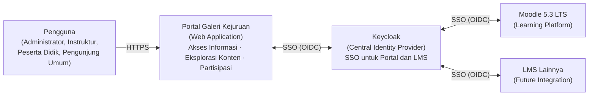
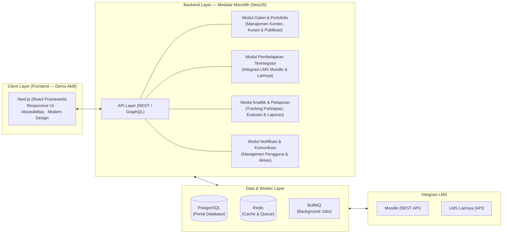
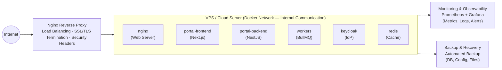

# Arsitektur Sistem & Aplikasi — Portal Galeri Kejuruan (`PGK-ARC-001`)

> [!IMPORTANT]
> **STATUS SAAT INI: VERSI DEMO (FRONTEND PROTOTYPE) — MENUNGGU INFORMASI FINAL**
>
> Implementasi di repositori ini baru mencakup **Client Layer (Frontend Next.js)** dalam status **demo** dengan data statis sementara. Bagian **Backend (NestJS)**, **SSO (Keycloak)**, **Database (PostgreSQL/Redis/BullMQ)**, dan **Integrasi LMS (Moodle 5.3 LTS)** pada bagian bawah dokumen ini merupakan **target arsitektur produksi (`PGK-ARC-001`)** yang masih menunggu informasi dan spesifikasi final sebelum dikembangkan.

---

## Bagian A — Cetak Biru Arsitektur Target (`PGK-ARC-001`)

Platform terintegrasi untuk mengelola, menampilkan, dan memanfaatkan karya serta pembelajaran kejuruan (**BBPPMPV Bidang Mesin dan Teknik Industri** — *"Berbagi Inspirasi, Membangun Kompetensi"*).

### 1. System Context (Alur Pengguna, SSO & LMS)

### 2. Application Architecture — Portal Galeri Kejuruan

- **Lapisan Keamanan (Security Layer)**: Firewall, WAF, Rate Limiting, SSL/TLS, RBAC, dan Audit Log melindungi seluruh komunikasi antar-layer.

### 3. Deployment Topology — Docker on VPS / Cloud

### 4. Data Ownership (Kepemilikan Data)
| Sistem | Data yang Dikelola |
| :--- | :--- |
| **Portal Galeri Kejuruan** | Galeri, Pengguna, Evaluasi |
| **Moodle 5.3 LTS** | Pembelajaran, Nilai, Aktivitas |
| **LMS Lainnya** | Sesuai spesifikasi integrasi |

### 5. Key Flows (Alur Utama Sistem)
1. **Akses Pengguna**: Pengguna mengakses Portal melalui HTTPS melewati Nginx Reverse Proxy menuju `portal-frontend` (Next.js) dan `portal-backend` (NestJS).
2. **SSO / Autentikasi**: Autentikasi terpusat menggunakan **Keycloak (OIDC)** sehingga satu akun berlaku untuk Portal dan LMS.
3. **Integrasi LMS**: Backend NestJS berkomunikasi dengan **Moodle REST API** (dan LMS lainnya di masa depan).
4. **Sinkronisasi Data**: Proses sinkronisasi dan tugas latar belakang dijalankan secara asinkron melalui **Redis + BullMQ Workers**.

### 6. Security Architecture
- **Enkripsi Data** (in-transit SSL/TLS & enkripsi data sensitif)
- **Kontrol Akses (RBAC)** berdasarkan peran (*Administrator*, *Instruktur*, *Peserta Didik*, *Pengunjung Umum*)
- **Audit & Monitoring** (Audit Log, Prometheus + Grafana)
- **Perlindungan Data Pribadi** & Automated Backup (DB, Config, Files)

---

## Bagian B — Arsitektur Frontend Demo Saat Ini (`frontend/`)

Bagian ini menjelaskan struktur teknis kode **Next.js Frontend** yang sudah tersedia di repositori ini.

### 1. Routing (Next.js App Router)
| Route | File | Keterangan |
| :--- | :--- | :--- |
| `/` | `src/app/page.tsx` | Halaman utama (landing page lengkap semua section) |
| `/galeria` | `src/app/galeria/page.tsx` | Katalog lengkap Galeria Kompetensi Keahlian |
| `/pelatihan-mandiri` | `src/app/pelatihan-mandiri/page.tsx` | Daftar lengkap modul & program Pelatihan Mandiri |

### 2. Urutan Section di Halaman Utama (`src/app/page.tsx`)
Urutan ini **harus konsisten** dengan urutan link di `Navbar.tsx` agar indikator *scroll-spy* pada *floating bottom dock* bergerak urut dari kiri ke kanan:

1. **`Navbar.tsx`** (`#nav`) — Navbar transparan atas (tanpa tombol burger) + *floating frosted-glass bottom dock* (`scrollY > 140px`) dengan *scroll-spy* otomatis.
2. **`Hero.tsx`** (`#hero`) — Hero putih bersih dengan ornamen SVG lengkungan & gelombang biru, teks sambutan animasi (`motion/react`), serta bar putih melayang berisi *marquee* 7 logo mitra industri.
3. **`Manifesto.tsx`** (`#manifesto`) — Penjelasan *"Perwujudan Gagasan lewat Materi Kejuruan"* dengan animasi latar navy melebar (`manifesto:entry`) dan efek teks menebal saat dibaca (`manifesto:read`).
4. **`Clubs.tsx`** (`#clubs`) — **Pelatihan Terbimbing** (4 program unggulan PKB, DUDI, DIKSI, VR/Metaverse).
5. **`Week.tsx`** (`#week`) — Carousel horizontal **Galeria Kompetensi Keahlian** (`<` `>`) + tautan ke `/galeria`.
6. **`Edit.tsx`** (`#edit`) — Carousel horizontal **Pelatihan Mandiri** (`<` `>`) + tautan ke `/pelatihan-mandiri`.
7. **`Board.tsx`** (`#board`) — Banner penuh **Capaian Galeri Kejuruan** (4 kartu statistik *glassmorphism* oranye–kuning emas).
8. **`Letter.tsx`** (`#letter`) — Kutipan **Pesan Kepala Balai Besar** & motto *"SMK Bisa, SMK Hebat!"*.
9. **`Membership.tsx`** (`#membership`) — **Alur Pembelajaran** 3 langkah dengan animasi *3D card flip*.
10. **`Journal.tsx`** (`#journal`) — **Testimonial Peserta** dengan *continuous infinite marquee* CSS.
11. **`Faq.tsx`** (`#faq`) — Daftar pertanyaan umum interaktif (`
`).
12. **`Contact.tsx`** (`#contact`) — Informasi kantor, kontak layanan (placeholder), pintu animasi (`.contact__door`), dan formulir pesan.
13. **`Footer.tsx`** (`#footer`) — Footer tautan & informasi instansi.

### 3. Sistem Animasi & Smooth Scroll
- **`src/components/ScriptLoader.tsx`**: memuat GSAP, ScrollTrigger, SplitText, Lenis, dan `/init-scripts.js` **setelah hydration React selesai penuh** agar **0 Hydration Error**, serta membersihkan trigger saat pindah halaman (`cleanupSoftlife`).
- **`public/init-scripts.js`**: menjalankan **Lenis Smooth Scroll** (`autoRaf: true`), **Scroll Reveal** (`IntersectionObserver threshold: 0.1` + CSS `0.7s ease` di `globals.css`), serta animasi khusus section (`manifesto`, `membership`, `contact`).

### 4. Aturan Penting saat Mengedit Frontend
- **Jangan menghapus `id` dan `data-8b-section`** pada tiap `<section>`.
- **Proyek ini tidak memakai Tailwind CSS** — gunakan class CSS dari `src/app/globals.css`, `<style>` scoped, atau inline `style` dengan CSS variables (`var(--color-1)` s/d `var(--color-8)`).
- Setelah mengubah `public/init-scripts.js`, cek sintaks dengan `node --check public/init-scripts.js`.
- Sebelum commit/push ke branch `dev`, pastikan `npm run build` lulus tanpa error.
